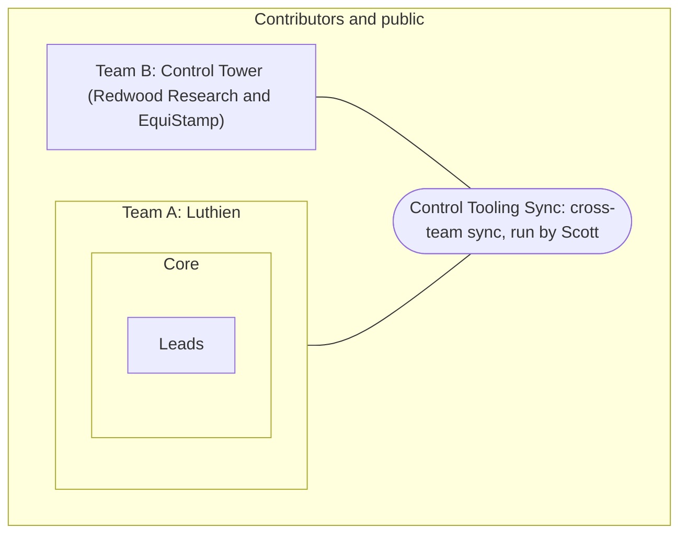

# Luthien contributors

Public tooling for people who contribute to [Luthien](https://luthien.cc): today, a Slack agent for the Seattle AI Safety workspace that answers questions, takes actions, and runs the team's async daily standup.

## Public code, private context

Despite the name, this is not a private space for Luthien contributors: everything here is public. This repo is public on purpose: the bot's internals (code, prompt rules, approval gate, tests) are open so anyone can read, reuse and improve them.

**All actual Luthien context lives in a private repo, never here.** That means people, projects, customers, meeting notes, decisions, partner material and anything shared with us in confidence. The agent is contributors-level only: its memory ("the brain") is the private repo [LuthienResearch/luthien-contributors-brain](https://github.com/LuthienResearch/luthien-contributors-brain), which holds only what everyone in #luthien-contributors may read and nothing from luthien-org; [`brain-template/`](brain-template/) holds only its empty scaffolding. Secrets live in Bitwarden and macOS Keychain, never in git. Process and tooling docs are public by default: see [`process/`](process/). Keep private only performance management, pay and funding amounts, NDA material, things shared in confidence, and Scott's personal life.

## Who can see what (access levels)

Luthien has three access levels. Each one has a Slack channel, and GitHub and Google Drive access follow the same levels. Levels nest: leads see everything core sees, and core sees everything contributors see. Before you post or file something, check that everyone at that level may read it; if not, move it one level in.

| Level | What it's for | Slack | GitHub | Google Drive |
|---|---|---|---|---|
| **Leads** | Day-to-day coordination for the people actively driving Luthien strategy, funding applications, client engagements (e.g., Faculty, Redwood) and core processes (hiring, project brief mechanisms). | #luthien-leads (private) | luthien-org (private) | Not set up yet |
| **Core** | Close collaborators and trusted voices. Deeper discussion on direction and decisions; join in as much or as little as your time allows. | #luthien-core (private) | luthien-org (private) | core@ |
| **Contributors** | Open to anyone working on Luthien or interested in getting involved. Updates, questions, and ways to help. | [#luthien-contributors](https://seattleaisafety.slack.com/archives/C0APTJLNWN6) (public channel in the Seattle AI Safety Slack) | [luthien-proxy](https://github.com/LuthienResearch/luthien-proxy), this repo (both public; write access on invite) | Docs shared as "anyone with the link can view"; contributors@ is being set up |

Contributors-level material is effectively public: anyone with the link can read it, and invited people can write. [luthien.cc](https://luthien.cc) is public too.

Leads and core currently share luthien-org on GitHub; it will be split so that each level gets only its own repo access.

### Getting involved

1. Join [#luthien-contributors](https://seattleaisafety.slack.com/archives/C0APTJLNWN6) in the Seattle AI Safety Slack.
2. Read the [Luthien Project Briefs](https://docs.google.com/document/d/1RYgVMUhNh_3Wpkapg-8WHlj1hJdbxa1aGzlCpRHyWoc/edit) and pick one that fits your skills and time.
3. Post in #luthien-contributors which brief you picked, your top uncertainty, and anything blocking you.
4. For code, start with [luthien-proxy](https://github.com/LuthienResearch/luthien-proxy). Ask in the channel for write access.

### Two teams

We run something like a two-team [Scaled Agile Framework](https://en.wikipedia.org/wiki/Scaled_agile_framework) setup: two teams with their own access, standups and repos, synced through one cross-team meeting that Scott runs.



| | Team A: Luthien | Team B: Control Tower |
|---|---|---|
| Members | Leads, core and contributors | Redwood Research and EquiStamp engineers, Scott |
| Private space | Leads and core levels above | Control Tower's own repo and Slack |
| Standup | Async daily in Slack, Friday weekly | Control Tower Standup, weekdays |
| Shared | Control Tooling Sync; public code in luthien-proxy and [control-tower](https://github.com/linuxarena/control-tower) | |

Nothing moves between the two teams' private spaces, or outward to a less private level, without Scott's approval.

## How it's built

- **Agent loop:** [Claude Agent SDK](https://pypi.org/project/claude-agent-sdk/) (Python), on a normal Anthropic API key.
- **Slack:** Bolt in Socket Mode. The bot connects out to Slack, so it needs no public URL.
- **Memory ("the brain"):** a clone of the private luthien-contributors-brain repo is the agent's working directory. Every session's edits are committed.
- **Approval gate:** [`agent/approvals.py`](agent/approvals.py). Every tool call is checked in code, not in the prompt.
- **Daily standup:** [`agent/standup.py`](agent/standup.py). See below.

The design follows publicly documented Agent SDK patterns and was inspired by Hal, Neolithic's Slack agent; no Neolithic code is in this repo.

## Daily standup

Each weekday at 8am Pacific, the bot posts in the standup channel:

1. What did you do?
2. What's next, and for which weekly goal?
3. What are you blocked on?

Reply in the thread on days you worked on Luthien. There's no standup meeting; blockers get picked up in the thread. The one live meeting is the Friday weekly.

Settings: `STANDUP_CHANNEL_ID` (channel to post in; empty turns it off; `scripts/run.sh` defaults to #luthien-contributors), `STANDUP_TIME` (default `08:00`), `STANDUP_TZ` (default `America/Los_Angeles`). Invite the bot to the channel first (`/invite @luthien-agent`).

## What it can do (version 0.1)

| Tool | Rule |
|---|---|
| Read / Glob / Grep, Write / Edit | Allowed only inside the brain folder |
| WebSearch / WebFetch | Allowed |
| Slack: read a thread, read a channel, list channels | Allowed (channels the bot is in) |
| Slack: post a message | Free in the requester's own thread; anywhere else shows Approve/Deny to the requester |
| Anything else, including shell commands | Denied |

If the requester doesn't click within 60 seconds, the action waits in a queue for up to 24 hours. A later Approve starts a new session that is allowed to make exactly that one call. The requester or anyone in `ADMIN_USER_IDS` can approve.

Not built yet: Google Workspace, Linear and read-only GitHub tools; scheduled follow-ups; meeting transcription; Slack search; running in a container on a cloud machine.

## Setup

1. **Create the Slack app.** At [api.slack.com/apps](https://api.slack.com/apps), choose Create New App → From a manifest, pick the Seattle AI Safety workspace, and paste [`slack-app-manifest.yaml`](slack-app-manifest.yaml). Install it to the workspace.
2. **Collect three secrets** and save each in Bitwarden (the source of truth for non-Redwood credentials):
   - Bot token (`xoxb-…`): OAuth & Permissions page.
   - App-level token (`xapp-…`): Basic Information → App-Level Tokens → generate one with the `connections:write` scope.
   - An Anthropic API key from the Luthien console.
3. **Copy them into macOS Keychain** for the launcher. Each command prompts for the value, so it never lands in shell history:
   ```sh
   security add-generic-password -s luthien.slack-agent -a slack-bot-token -w
   security add-generic-password -s luthien.slack-agent -a slack-app-token -w
   security add-generic-password -s luthien.slack-agent -a anthropic-api-key -w
   ```
4. **Clone the brain** (private; ask a Luthien admin for access):
   ```sh
   git clone https://github.com/LuthienResearch/luthien-contributors-brain.git ~/build/luthien-contributors-brain
   ```
5. **Run:** `scripts/run.sh` from a separate clone used only for running the bot (see Security notes). Then invite the bot to a channel (`/invite @luthien-agent`) and mention it.

Optional environment variables: `ALLOWED_USER_IDS` (comma-separated Slack user IDs; empty means any member of the workspace), `ADMIN_USER_IDS` (comma-separated Slack user IDs who can approve anyone's pending actions), `AGENT_MODEL` (default `claude-sonnet-5-5`), `MAX_BUDGET_USD` per session (default 3), `BRAIN_DIR`.

Each session pulls the latest brain first and commits its changes at the end. The prompt cache is set to 1 hour, because Slack replies are often more than 5 minutes apart.

## Security notes

- Only members of the Seattle AI Safety workspace get answers. Slack Connect guests from other organizations (for example in the shared Redwood channels) are ignored.
- The agent runs with an isolated Claude Code config folder (`.agent-claude-config/`), so the host user's settings, hooks and CLAUDE.md files never load.
- Anyone in the Slack workspace can ask the agent about brain content, so the brain holds contributors-level material only. Keep the bot out of private channels, because it can read every channel it's in. The prompt forbids storing secrets, compensation, performance feedback and health data.
- **Known gap:** WebFetch is auto-allowed, so a prompt injection in Slack or on a web page could try to leak brain contents through a URL. That's low risk while the brain is contributors-level; move WebFetch behind approval before giving the bot anything more private.
- **Contributors can push to main**, so main is not reviewed. The machine that runs the bot holds its Slack and Anthropic keys and the brain clone, so run it from a separate clone and update that clone only after reading the diff (`git fetch && git diff HEAD origin/main`, then `git merge origin/main`). Never `git pull` blind in the run clone.
- **Known gap:** running on a laptop means the agent shares that machine. The path checks block file access outside the brain, but a container on a dedicated machine is the stronger boundary.

## Development

```sh
uv sync
uv run pytest
```
