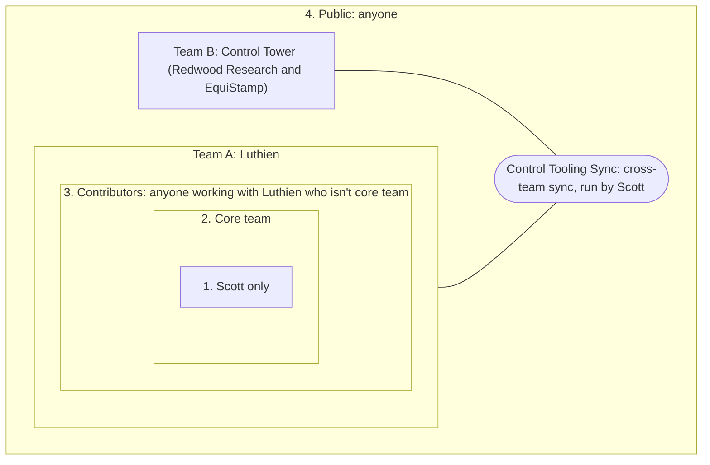

# Luthien contributors

Public tooling for people who contribute to [Luthien](https://luthien.cc): today, a Slack agent for the Seattle AI Safety workspace that answers questions, takes actions, and runs the team's async daily standup.

## Public code, private context

Despite the name, this is not a private space for Luthien contributors: everything here is public. This repo is public on purpose: the bot's internals (code, prompt rules, approval gate, tests) are open so anyone can read, reuse and improve them.

**All actual Luthien context lives in a private repo, never here.** That means people, projects, customers, meeting notes, decisions, partner material and anything shared with us in confidence. The agent's memory ("the brain") is the `brain/` folder of the private repo [LuthienResearch/luthien-org](https://github.com/LuthienResearch/luthien-org/tree/main/brain); [`brain-template/`](brain-template/) holds only its empty scaffolding. Secrets live in Bitwarden and macOS Keychain, never in git. If you're unsure whether something is context or internals, put it in the private repo.

## Who can see what (access tiers)

Each tier is defined by who can actually read it. Tiers nest: everyone in an inner tier can read everything in the outer ones. Before you file something, check that everyone in the tier may read it; if not, file it one tier further in.

We run something like a two-team [Scaled Agile Framework](https://en.wikipedia.org/wiki/Scaled_agile_framework) setup: two teams with their own access, standups and repos, synced through one cross-team meeting that Scott runs.



| Tier | Who | Places |
|---|---|---|
| 1 | Scott | Scott's private repo |
| 2 | Core team | luthien-org (private repo, including the agent's brain), core@, #luthien-leads, Luthien group DM |
| 3 | Contributors: partner orgs, open-source contributors, paid contractors, people on a work trial | contributors@, Google Docs shared with them |
| 4 | Anyone | [luthien-proxy](https://github.com/LuthienResearch/luthien-proxy), this repo, [luthien.cc](https://luthien.cc), #luthien-contributors (public channel in the Seattle AI Safety Slack) |

| | Team A: Luthien | Team B: Control Tower |
|---|---|---|
| Members | Core team and contributors | Redwood Research and EquiStamp engineers, Scott |
| Private space | Tiers 1 to 3 above | Control Tower's own repo and Slack |
| Standup | Async daily in Slack, Friday weekly | Control Tower Standup, weekdays |
| Shared | Control Tooling Sync; public code in luthien-proxy and [control-tower](https://github.com/linuxarena/control-tower) | |

Nothing moves between the two teams' private spaces, or outward to a less private tier, without Scott's approval.

## How it's built

- **Agent loop:** [Claude Agent SDK](https://pypi.org/project/claude-agent-sdk/) (Python), on a normal Anthropic API key.
- **Slack:** Bolt in Socket Mode. The bot connects out to Slack, so it needs no public URL.
- **Memory ("the brain"):** the `brain/` folder of a private luthien-org clone is the agent's working directory. Every session's edits are committed, and git commands touch only that folder.
- **Approval gate:** [`agent/approvals.py`](agent/approvals.py). Every tool call is checked in code, not in the prompt.
- **Daily standup:** [`agent/standup.py`](agent/standup.py). See below.

The design follows publicly documented Agent SDK patterns and was inspired by Hal, Neolithic's Slack agent; no Neolithic code is in this repo.

## Daily standup

Each weekday at 8am Pacific, the bot posts in the standup channel:

1. What did you do?
2. What's next, and for which weekly goal?
3. What are you blocked on?

Reply in the thread on days you worked on Luthien. There's no standup meeting; blockers get picked up in the thread. The one live meeting is the Friday weekly.

Settings: `STANDUP_CHANNEL_ID` (channel to post in; empty turns it off; `scripts/run.sh` defaults to #luthien), `STANDUP_TIME` (default `08:00`), `STANDUP_TZ` (default `America/Los_Angeles`). Invite the bot to the channel first (`/invite @luthien-agent`).

## What it can do (version 0.1)

| Tool | Rule |
|---|---|
| Read / Glob / Grep, Write / Edit | Allowed only inside the brain folder |
| WebSearch / WebFetch | Allowed |
| Slack: read a thread, read a channel, list channels | Allowed (channels the bot is in) |
| Slack: post a message | Free in the requester's own thread; anywhere else shows Approve/Deny to the requester |
| Anything else, including shell commands | Denied |

If the requester doesn't click within 60 seconds, the action waits in a queue for up to 24 hours. A later Approve starts a new session that is allowed to make exactly that one call. The requester or anyone in `ADMIN_USER_IDS` can approve.

Not built yet: Google Workspace, Linear and read-only GitHub tools; scheduled follow-ups; meeting transcription; Slack search; running in a container on a cloud machine.

## Setup

1. **Create the Slack app.** At [api.slack.com/apps](https://api.slack.com/apps), choose Create New App → From a manifest, pick the Seattle AI Safety workspace, and paste [`slack-app-manifest.yaml`](slack-app-manifest.yaml). Install it to the workspace.
2. **Collect three secrets** and save each in Bitwarden (the source of truth for non-Redwood credentials):
   - Bot token (`xoxb-…`): OAuth & Permissions page.
   - App-level token (`xapp-…`): Basic Information → App-Level Tokens → generate one with the `connections:write` scope.
   - An Anthropic API key from the Luthien console.
3. **Copy them into macOS Keychain** for the launcher. Each command prompts for the value, so it never lands in shell history:
   ```sh
   security add-generic-password -s luthien.slack-agent -a slack-bot-token -w
   security add-generic-password -s luthien.slack-agent -a slack-app-token -w
   security add-generic-password -s luthien.slack-agent -a anthropic-api-key -w
   ```
4. **Clone the brain** (private; ask a Luthien admin for access). Use a dedicated sparse clone that checks out only `brain/`, so the rest of luthien-org never sits in the agent's clone:
   ```sh
   git clone --filter=blob:none --sparse https://github.com/LuthienResearch/luthien-org.git ~/build/luthien-org-agent-brain
   git -C ~/build/luthien-org-agent-brain sparse-checkout set brain
   ```
5. **Run:** `scripts/run.sh`. Then invite the bot to a channel (`/invite @luthien-agent`) and mention it.

Optional environment variables: `ALLOWED_USER_IDS` (comma-separated Slack user IDs; empty means any member of the workspace), `ADMIN_USER_IDS` (comma-separated Slack user IDs who can approve anyone's pending actions), `AGENT_MODEL` (default `claude-sonnet-5-5`), `MAX_BUDGET_USD` per session (default 3), `BRAIN_DIR`.

Each session pulls the latest brain first and commits its changes at the end. The prompt cache is set to 1 hour, because Slack replies are often more than 5 minutes apart.

## Security notes

- Only members of the Seattle AI Safety workspace get answers. Slack Connect guests from other organizations (for example in the shared Redwood channels) are ignored.
- The agent runs with an isolated Claude Code config folder (`.agent-claude-config/`), so the host user's settings, hooks and CLAUDE.md files never load.
- Brain content is visible to everyone with access to luthien-org, and anyone in the Slack workspace can ask the agent about it. The prompt forbids storing secrets, compensation, performance feedback and health data.
- **Known gap:** WebFetch is auto-allowed, so a prompt injection in Slack or on a web page could try to leak brain contents through a URL. Before widening access, consider moving WebFetch behind approval.
- **Known gap:** running on a laptop means the agent shares that machine. The path checks block file access outside the brain, but a container on a dedicated machine is the stronger boundary.

## Development

```sh
uv sync
uv run pytest
```
